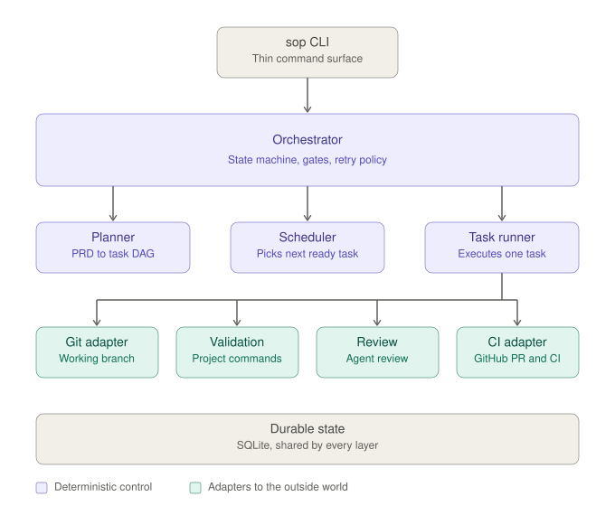
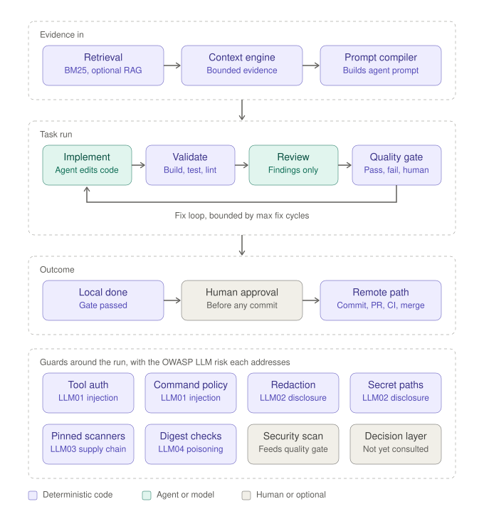

# Architecture Diagrams

**Type:** Descriptive architecture reference

Two pictures of the system described in [OVERVIEW.md](OVERVIEW.md) and
[COMPONENTS.md](COMPONENTS.md). They summarize those documents and are not
normative; where a diagram and a spec disagree, the spec wins.

## Top-level components

The CLI stays thin and hands off to the orchestrator, which owns state,
transitions, gates, and retry policy. Agents propose and execute work; the
orchestrator decides what state the workflow is in and what may happen next.

- The remote path behind the CI adapter (commit → PR → CI → merge) is **partial**:
  the components exist, but the CLI does not yet drive a project through them end
  to end.
- The planned orchestrator time budget is not drawn, because no request timeout is
  enforced today.

## One task run

- **Evidence in.** BM25 is the default retriever. RAG is optional, disabled by
  default, and only adds low-priority evidence to the context engine. See
  [RAG-RETRIEVAL-INTEGRATION.md](RAG-RETRIEVAL-INTEGRATION.md).
- **Review.** The agent or an external review command produces findings. It does
  not decide whether they block.
- **Quality gate.** The run's decision is computed in code from validation status,
  blocking findings, the fix budget, and human-required flags: `PASS`, `FAIL`, or
  `NEEDS_HUMAN`.
- **Fix loop.** A failed validation or a blocking finding goes back to the agent.
  The loop is bounded by `quality.max_fix_cycles`; exhausting it yields
  `NEEDS_HUMAN`.
- **Guards.** The optional security scan feeds its evidence into the quality gate.
  The optional decision layer is configured but not yet consulted by the run. The
  other six guards are labelled with the OWASP LLM risk they address:

  | Risk                                   | Guards drawn                                                                                                                                              | Status           |
  | -------------------------------------- | --------------------------------------------------------------------------------------------------------------------------------------------------------- | ---------------- |
  | LLM01 Prompt Injection                 | Tool authorization and command policy limit what an injected model can do.                                                                                | Covered, bounded |
  | LLM02 Sensitive Information Disclosure | Redaction covers the user prompt, tool results, diagnostics, and notifications before they reach a model. File tools refuse credential paths.             | Covered, bounded |
  | LLM03 Supply Chain                     | Scanner archives are SHA-256-pinned in CI; optional binary and rules pins are checked before every scanner run.                                           | Partial          |
  | LLM04 Data and Model Poisoning         | Repository index rows carry digests and RAG chunks are hash-verified. A digest proves the bytes are unchanged, not that the content is benign.            | Partial          |

  The statuses, limits, and evidence for all ten risks are in
  [../reports/owasp-llm/coverage-statement.md](../reports/owasp-llm/coverage-statement.md);
  that file is authoritative. The opt-in OS sandbox for commands is not drawn.

Two loops are not drawn: graph execution (the scheduler picks the next ready
task and the same run repeats) and the bounded CI remediation loop on the remote
path.
