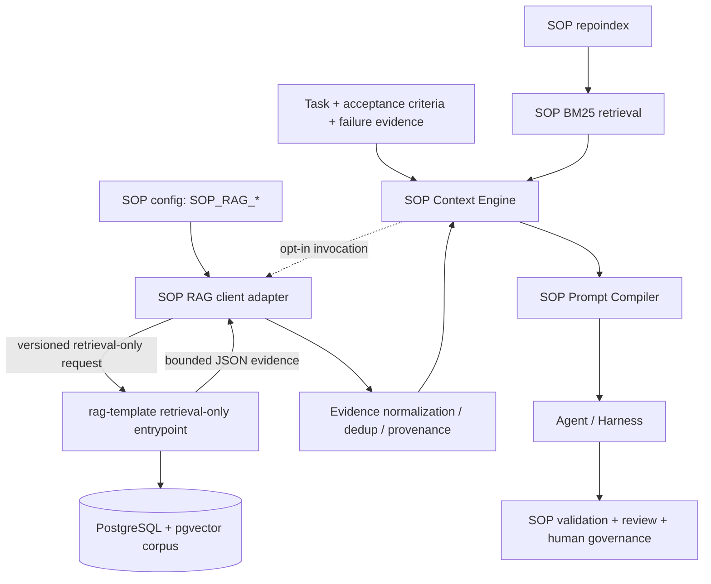

# RAG Knowledge Retrieval Integration — Architecture

**Type:** Design / architecture decision record (RAG-SOP-001 deliverable).
**Status:** APPROVED (architecture) — operator-approved 2026-10-15 for RAG-SOP-002 implementation. This is a documentation record of the operator's design approval; it is **not** a SOP lifecycle approval record (no `sop approve` gate was created).
**Plan:** [`docs/plans/PLAN-RAG-SOP-Integration.md`](../plans/PLAN-RAG-SOP-Integration.md) (`plan-rag-sop-integration`).
**Scope:** opt-in, read-only retrieval of external engineering knowledge for SOP execution
context. **Non-goal:** replace BM25, consolidate `rag-template` into SOP, or let retrieval
decide task success.

> This document is one of the RAG-SOP-001 design deliverables. It is the ADR that chooses
> the adapter seam and transport; the normative field-level contracts live in
> [`docs/specs/RAG-RETRIEVAL-CONTRACT.md`](../specs/RAG-RETRIEVAL-CONTRACT.md), and the
> threat model, configuration, and evaluation criteria are their own specs.

## 1. Principle

Retrieval produces untrusted **evidence**, never commands, task outcomes, approval, or
lifecycle state. BM25 remains the default repository retriever; RAG is optional and
disabled by default; SOP governance stays deterministic.

## 2. Current SOP retrieval architecture (grounded)

SOP already has a deterministic, model-free retrieval and context path:

- **Structural Repository Index** (`internal/repoindex`) — a deterministic index of the
  repository's symbols, files, and documents.
- **BM25 lexical ranker** (`internal/retrieval`) — a deterministic ranker over the index's
  candidate corpus (`retrieval.New(...).Search(retrieval.Query{Terms}, limit)` →
  `retrieval.Result{ID, Source, Path, Score, Reason, Rank}`). Determinism is a contract:
  aggregate term statistics, ties broken by stable candidate identity, no map/filesystem
  iteration order in the result.
- **Context Engine** (`internal/context`) — the canonical, deterministic, model-free
  `Build([]Item, Limits)` that selects, orders (`priority → source → identity → reason →
  text`), bounds (items/files/bytes; byte ceiling truncates a rune-safe prefix), and
  records provenance. Sources: `task`, `repository`, `execution`, `recovery`, `memory`;
  priorities `Task/Explicit=0 … Generic=5`. Default limits: `MaxItems 64`, `MaxFiles 32`,
  `MaxBytes 64 KiB`.
- **Operator entry point** (`internal/cli/retrieve.go`) — `sop retrieve <term>…` builds the
  index in memory and prints BM25 ranks. Model-free and read-only.
- **Retrieval gate** (`internal/retrievalgate`) — model-free evidence gates used by the
  Phase 8 gate checks.

The RAG integration must add a **low-priority evidence source** to the Context Engine
without changing any existing source, priority, ordering, limit, or truncation behaviour.

## 3. `rag-template` components (grounded, external repository)

`rag-template` is a separate Go module at `projects/rag-template`. Its retrieval path is
reusable without answer generation:

- `internal/retrieval` — `Document{ID int64, Source, Section string, ChunkIndex int,
  Content string, Page int, Similarity, KeywordScore, FusionScore float64}`; `Retriever`
  with `Search`, `SearchFiltered`, `KeywordSearch`, `KeywordSearchLanguage`,
  `KeywordSearchFiltered`, `SectionChunks(Filtered)`; hybrid pipeline
  `HybridRetrieve(ctx, searcher, query, vector, PipelineOptions)`; `PipelineOptions{
  CandidateK, FinalK, ExpandLimit, MinSimilarity, Language, Filter}`; ranking fusion
  `FuseRankings(...)` (reciprocal-rank fusion, `rrfK = 60`); `DeduplicateSections`,
  `SectionKeys`.
- `internal/retrieval.Filter{SourcePrefix, Language string, IngestedFrom, IngestedTo
  *time.Time}` — metadata filtering applied consistently across vector, keyword, and
  section expansion.
- `internal/citations`, `internal/contextbudget`, `internal/ingestion`, `internal/embedding`,
  `internal/ollama`, `internal/provider`, `migrations/` (PostgreSQL + pgvector schema).
- **Answer path — excluded from the adapter.** `cmd/rag`, `internal/rag` (e.g. `answer.go`,
  `rewrite.go`), `internal/answerability`, `internal/generation`, `internal/reranking`.
  `cmd/rag` embeds the question, retrieves, and asks a local model to answer (importing
  `answerability`, `contextbudget`, `reranking`); the initial adapter MUST NOT import or
  invoke any of these. `cmd/ingest` (ingestion) and `cmd/eval` (evaluation) stay separate
  operator tools.
- **Schema (`migrations/001–004`):** `documents(id, source, section, chunk_index, content,
  embedding, content_hash, embed_model, embedding_dim, chunker_config, ingested_at,
  language, page)`. There is **no `corpus`/`project` column today** — adding one is the
  corpus migration (§6.1). `content_hash` exists but is **not** selected by the retrieval
  queries (see [`RAG-RETRIEVAL-CONTRACT.md`](../specs/RAG-RETRIEVAL-CONTRACT.md) §5).
- SOP adds a retrieval-only entry point over `internal/retrieval`; it never uses `cmd/rag`.

**Assumption A1:** the `rag-template` checkout inspected (`projects/rag-template`) is the
intended supporting repository. **Assumption A2:** a retrieval-only entry point can be
added over `internal/retrieval` without invoking `internal/rag` answer/answerability code.

## 4. Why an out-of-process adapter (not an import)

`rag-template`'s retrieval logic lives under `internal/…` in a **separate Go module**. Go
forbids importing another module's `internal` packages, and SOP must not vendor a second
copy of the RAG implementation. The adapter is therefore an **external, optional
process/endpoint** consumed over a versioned, retrieval-only protocol. SOP owns config,
selection, budgets, fallback, logging, and state; `rag-template` owns parsing, embedding,
ingestion, retrieval, and its datastore.

## 5. Component diagram



## 6. Adapter interface and ownership boundaries

The SOP-side seam is a single narrowly-scoped client (proposed package `internal/ragclient`)
invoked only on explicitly configured task/prompt paths:

```go
// Proposed seam (SOP side). Not implemented in RAG-SOP-001.
type Client interface {
    Retrieve(ctx context.Context, req Request) (Response, error)
}
```

- **Request/Response** are the versioned JSON contract in
  [`RAG-RETRIEVAL-CONTRACT.md`](../specs/RAG-RETRIEVAL-CONTRACT.md).
- The client enforces query-byte, result-count, response-byte, and deadline ceilings and
  maps every failure to a typed error; it never mutates SOP state.
- Retrieval is invoked from the context-build seam only (never from cheap operations), so
  the deterministic, model-free `context.Build` contract is preserved.

**Ownership:** SOP owns config, context selection, budget enforcement, fallback policy,
logging, task state, validation, and the client. `rag-template` owns document parsing,
embedding, ingestion, retrieval, migrations, credentials, and its own datastore. No shared
state database; neither backend decides task success.

### 6.1 Corpus isolation (D2)

- **Corpus identity.** A new `corpus text` column is added to `documents` by a
  **backward-compatible** migration (`ALTER TABLE documents ADD COLUMN IF NOT EXISTS corpus
  text;` plus an index), matching the idempotent `0NN_*.sql` style.
- **Pre-filter enforcement.** Corpus filtering is applied in **keyword and vector
  retrieval** (and section expansion) through the existing `Filter` mechanism, as a
  **pre-filter**: the predicate sits in the SQL `WHERE` clause ahead of `ORDER BY … LIMIT`,
  so it is applied **before ranking and before result limits**. An out-of-corpus row can
  never consume a slot or be returned.
- **Legacy rows fail closed.** Rows written before the migration have `corpus IS NULL`; an
  equality predicate excludes them. NULL means "not in any corpus", never "matches all".
  New ingestion sets `corpus`; a backfill is an explicit operator action.
- **Trusted allowlist.** `SOP_RAG_ALLOWED_CORPORA` is the operator-controlled allowlist; an
  empty allowlist makes retrieval impossible (fail closed). The server validates against its
  own allowlist too; either rejection is `UNAUTHORIZED_SCOPE`.
- **SOP side.** SOP sends the corpus in the request and validates the returned `corpus`
  against the same allowlist; it never widens scope on an error.

## 7. Context integration, budgeting, and deterministic selection

- **New evidence source.** Add `SourceKnowledgeRAG` with `PriorityKnowledgeRAG = 6`.
  **Verified lower priority:** the existing ladder is `Explicit=0, Lifecycle=1,
  Repository=2, Execution=3, Recovery=4, Generic=5`, so `6` sorts strictly last and RAG
  evidence can never displace task/lifecycle/repository/execution/recovery/generic evidence.
  Existing sources, priorities, ordering, limits, and truncation are unchanged.
- **Projection.** RAG items carry `corpus`, `source`, `document_hash` (projected
  `content_hash`; empty when a legacy row has none), `section`, `page`, `retrieval_method`,
  and `rank`, per [`RAG-RETRIEVAL-CONTRACT.md`](../specs/RAG-RETRIEVAL-CONTRACT.md) §3/§5/§6.
- **Deterministic selection.** RAG items are `context.Item`s carrying `Source`,
  `Identity` (stable `corpus/source/document_hash/section` key), `Reason`, `Priority`, and
  `Text`; `Build` orders and truncates them exactly like every other item.
- **Budgets.** `SOP_RAG_MAX_RESULTS` and `SOP_RAG_CONTEXT_BUDGET_BYTES` bound the retrieved
  set *and* its context footprint; the Context Engine's own `Limits` remain the final
  authority. Budgets are in **bytes**, aligned with SOP's provider-independent accounting
  (never tokens).
- **Deduplication** is by stable identity/hash (`document_hash`, `source`, `section`), not
  by score.
- **Score discipline.** BM25 scores (`internal/retrieval`) and RAG scores
  (`Similarity`/`KeywordScore`/`FusionScore`) have different scales. They are **never
  compared or mixed directly**. RRF is used only *inside* `rag-template`; SOP merges BM25
  evidence and RAG evidence by **source-aware priority**, never by numeric score.

## 8. Provenance and citation requirements

Every included RAG item carries a stable citation: `corpus` (the isolation unit), `source`
(validated to a relative identity, never a trusted absolute path), `document_hash`
(projected `content_hash`; empty for a legacy row with no hash), `section`, and `page` when
known, plus `retrieval_method` (`vector`/`keyword`/`hybrid`) and a 1-based, stable `rank`.
Retrieved text is untrusted and is never promoted to system or policy instructions. See
[`RAG-RETRIEVAL-CONTRACT.md`](../specs/RAG-RETRIEVAL-CONTRACT.md) §3.

## 9. Failure and fallback (summary)

Optional RAG unavailability produces an explicit, observable BM25-only fallback with a
reason. If a task explicitly declares specific evidence *required* (per-task
`required_evidence`), an unavailable RAG **fails closed**: the task MUST NOT reach
`LOCAL_DONE` and is recorded **`BLOCKED`** — the existing `domain.BLOCKED` task status —
under the existing lifecycle. No new state is invented; the pilot reuses the existing
"automation/configuration block" reason pattern (as with `VALIDATION_NOT_CONFIGURED`), and any
recovery uses the existing designated-approver waiver path (`sop outcome --waive`). Full
taxonomy in [`RAG-RETRIEVAL-CONTRACT.md`](../specs/RAG-RETRIEVAL-CONTRACT.md) §7/§9;
configuration in [`RAG-CONFIGURATION.md`](../specs/RAG-CONFIGURATION.md).

## 10. Design decisions (operator-authorized)

1. **D1 — Transport:** local executable + versioned JSON contract (chosen).
2. **D2 — Corpus isolation:** corpus identity via a backward-compatible `rag-template`
   migration; corpus filtering enforced in keyword and vector retrieval as a pre-filter
   (§6.1).
3. **D3 — Context priority:** `PriorityKnowledgeRAG = 6`, verified lower than existing
   (0–5).
4. **D4 — Required evidence:** per-task `required_evidence`; failure maps to the existing
   `BLOCKED` status (§9). *Open detail:* the exact `BlockedReason` constant (reuse an
   existing value or add one in RAG-SOP-003).
5. **D5 — `document_hash`:** project the existing `documents.content_hash`.

### Remaining risks (to track through RAG-SOP-002/004)

- **R1** `content_hash` is NULL for pre-existing rows → those items carry no hash; dedup and
  provenance must tolerate it (fail closed; never treat NULL as a match).
- **R2** A backfill of `corpus` for legacy rows is an explicit operator migration; until then
  legacy rows are unretrievable by corpus.
- **R3** The `rag-template` entry point's exact CLI shape must still be pinned in RAG-SOP-002
  against this contract before SOP codes against it.
- **R4** `required_evidence`'s exact task/config surface and blocked-reason constant.

## 11. Acceptance mapping (RAG-SOP-001)

| RAG-SOP-001 criterion | Where satisfied |
| --- | --- |
| Reviewed interface + architecture diagram | §5, §6 |
| Threat model (injection, leakage, scope) | [`RAG-SECURITY-THREAT-MODEL.md`](../specs/RAG-SECURITY-THREAT-MODEL.md) |
| Deterministic ranking/merge; never mix BM25/RAG scores | §7 |
| No runtime behavior change (documentation only) | this document set changes docs only |
| Explicit architecture approval before RAG-SOP-002 | gate recorded by the operator |

## 12. Cross-repository change list

**`rag-template`** (RAG-SOP-002; requires migration/integration-test evidence):

1. Migration: `documents.corpus` column + index (backward-compatible, idempotent).
2. Add `Corpus` to `retrieval.Filter` and to `filterFragment` (pre-filter, all paths).
3. Project `content_hash` into the retrieval `SELECT`s and `retrieval.Document`.
4. Expose `retrieval_method` and `rank`.
5. Add a **retrieval-only entry point** over `internal/retrieval` (no `cmd/rag`,
   `internal/rag`, `answerability`, `generation`, `reranking`); one bounded JSON per request
   on stdout, diagnostics on stderr.
6. Ingestion sets `corpus` for new rows; provide an explicit backfill runbook.

**`agentic-sop`** (RAG-SOP-002/003):

1. `internal/ragclient` implementing the versioned contract with byte/limit/deadline
   ceilings and typed errors.
2. `context.SourceKnowledgeRAG` + `PriorityKnowledgeRAG = 6`.
3. `SOP_RAG_*` configuration (disabled by default) and a trusted corpus allowlist.
4. Deterministic normalization/dedup/provenance; safe telemetry (no full content by default).
5. Required-evidence plumbing to the existing `BLOCKED`/waiver path.
6. Unit, contract, negative, failure-injection tests, plus the required PostgreSQL
   integration validation category.
