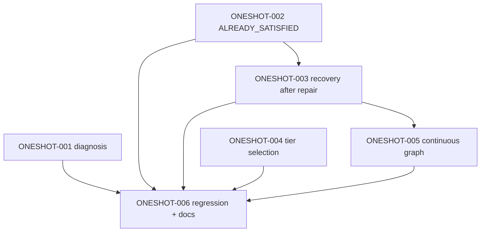

# PLAN — End-to-End One-Shot Hardening

**Type:** Reliability-hardening plan for SOP's own end-to-end execution (`sop run`). **Planning only — no runtime change.**
**Status:** PROPOSED — not activated. Requires operator approval before any task runs.
**Baseline:** `agentic-sop` `main` @ `72a463c` (includes the merged Validation Evidence Reuse work).
**Derived from:** the Validation Evidence Reuse execution (VER-001..VER-004) in worktree `agentic-sop-ver` @ `8b99ae0`.
**Does not** change product behavior; it hardens SOP's ability to complete an approved multi-task plan without repeated manual intervention for recoverable failures.

## Project
agentic-sop

## Summary

A single `/sop-end-to-end` invocation should drive an approved plan to completion. In the VER execution it did not: four **recoverable** conditions each forced manual intervention (`sop approve --run` / re-invoking `sop run`), and one task (`VER-004`) never ran. This plan makes those conditions self-recovering while preserving every **genuine** approval boundary and fail-closed validation.

## Diagnosis (source-grounded)

### Observed transitions (VER)
- `VER-001`: PASSED only on the 4th continuation, after the agent made a real mutation (strengthened `ver001_test.go`). Attempts 2/3/4 first hit `ALREADY_SATISFIED rejected`.
- `VER-002`: PASSED after 2 fix cycles; its objective outcome was `HOLD` because a plan acceptance check contained a `|` (rejected as a shell metacharacter).
- `VER-003`: `IMPLEMENT ALREADY_SATISFIED rejected` → `CONTINUE (INCOMPLETE_IMPLEMENTATION)` → after a review `FAIL` + `sop approve VER-003 --run` → `ALREADY_SATISFIED rejected` again → **`BLOCKED` ("retry budget exhausted")**.
- `VER-004`: never ran (DAG-blocked behind `VER-003`).
- Tier: every task derived **MEDIUM**, so the LOW targeted set was never selected.

### Root causes
- **RC-1 — ALREADY_SATISFIED is model-evidence-gated.** `internal/ollamaagent/already_satisfied.go` (`verifySatisfiedDetailed`) accepts a no-mutation claim only when the model submits a conformant `CompletionEvidence` block (each declared criterion mapped to paths that were actually **read**) plus in-process `ValidationCommands`. A smaller model cannot, so a genuinely-complete task is rejected (`internal/ollamaagent/orchestrate.go:393-423`).
- **RC-2 — no recovery after an externally repaired failure.** `go build ./...` failed, auto-FIX exhausted 3/3 (`internal/quality/quality.go:188`, `DefaultMaxFixCycles=3`), then the operator repaired the build — but SOP had no path to re-observe the repair and continue; the agent's `ALREADY_SATISFIED` claim was rejected again and the task went `BLOCKED`.
- **RC-3 — verification tier collapses to MEDIUM.** `internal/cli/verification_tier.go:19-23` calls `router.SignalsFrom(nil, …)`, so `JEVAvailable=false` and `verify.Derive` always returns `MEDIUM` (`internal/verify/verify.go:128-141`); LOW is reachable only via an operator `verify-first` declaration. The configured LOW targeted set is therefore dead code, and the standard (full) set runs even for package-scoped tasks.
- **RC-4 — one invocation exits at each gate.** On `NEEDS_HUMAN`, `driveGraph` (`internal/cli/drive.go`) persists the gate and the process exits with "Run paused: human approval required"; continuing requires a fresh `sop run`. Recoverable requeues (`CONTINUE`) likewise need manual re-invocation.
- **RC-5 — stage-id grammar (plan authoring).** `mdIDToken` (`internal/planner/markdown.go:26`) requires a letters-only prefix before the numeric segment. `E2E-001` parses as id `E2E` (the interior `2` truncates it), so six `E2E-00x` headings would collide on one id and fail DAG validation. The operator's `E2E-00x` labels are therefore carried as **`ONESHOT-00x`** stage ids (mapped below).

### Reusable existing hardening (uncommitted on `main`)
The 30-path WIP implements SOP-HARD-01..05 (`docs/plans/PLAN-SOP-Acceptance-Verification-Hardening.md`): verdict gating (`internal/cli/run.go`, `internal/outcome`), machine-checkable acceptance (`internal/planner/lint.go`), **`ALREADY_SATISFIED` robustness + validation waiver** (`internal/ollamaagent/already_satisfied.go`, `internal/outcome/waiver.go`), and recovery (`sop verify`, `sop outcome --waive`). This plan **extends** that work; it does not duplicate it. Each `ONESHOT` task must be implemented on top of the WIP, not from the older `8980826` baseline.

## Design constraints
- Extend the existing lifecycle/outcome/gate/verification components. No new orchestration subsystem, database, or service.
- Preserve fail-closed validation and every genuine human approval boundary.
- Never convert failed, missing, or incomplete evidence into PASS.
- Keep retries bounded; never repeat an identical attempt.
- Reuse valid validation evidence where possible; do not run the full Go test suite unnecessarily.
- Preserve existing user changes and worktrees. Test names use the `TestOneShot` prefix so acceptance checks stay targeted (the `internal/cli` full suite hangs on a pre-existing SQLite test).

## ONESHOT-001 — E2E-001 State-transition and gate diagnosis

Risk: LOW. Affected packages: `docs/`, `internal/cli` (tests only). Evidence required: a diagnosis artifact and deterministic transition tests.

### Deliverables
- `docs/reference/E2E-ONE-SHOT-DIAGNOSIS.md` — the VER transitions and the classification/gate/retry/tier decision points, each with exact source references and run-artifact paths.
- `internal/cli/oneshot_diagnosis_test.go` — deterministic tests pinning: dirty/clean gate selection, `ALREADY_SATISFIED` rejection shape, `AUTO_FIX_EXHAUSTED` classification, and MEDIUM tier derivation.

### Acceptance Criteria
- The diagnosis cites exact source locations and the preserved run artifacts under `.agent-sdlc/runs/`.
- Each transition is reproduced deterministically with no external infra and no behavior change.

### Acceptance Checks
- `go build ./...`
- `go vet ./internal/cli/...`
- `go test ./internal/cli/ -run TestOneShot`

### Dependencies
- None

## ONESHOT-002 — E2E-002 Verified ALREADY_SATISFIED handling

Risk: HIGH (a no-mutation completion is safety-sensitive; must remain fail-closed). Affected packages: `internal/ollamaagent`, `internal/outcome`, `internal/cli`. Evidence required: accept + reject tests.

### Deliverables
- An **independent** acceptance path in `internal/ollamaagent` that verifies a task's own declared criteria itself — executing the task's deterministic acceptance checks (`internal/cli/outcome.go`) and confirming the deliverable exists — so a genuinely-complete task is accepted with **zero** repository mutations without depending on a model-authored evidence block. Reuse and extend SOP-HARD-03's normalized criterion matching.
- Preserve the strict path: an explicit claim with conformant evidence still accepts; unmet criteria, missing/failed/partial evidence, or a changed repository fingerprint still reject.

### Acceptance Criteria
- A task whose acceptance checks pass and whose deliverable is present is accepted with zero mutations.
- A task with an unmet criterion, unreadable evidence path, or failed/absent validation is still rejected (never reused as PASS).
- No model claim alone can establish acceptance.

### Acceptance Checks
- `go build ./...`
- `go vet ./internal/ollamaagent/... ./internal/outcome/...`
- `go test ./internal/ollamaagent/ -run TestOneShot`

### Dependencies
- None

## ONESHOT-003 — E2E-003 Automatic recovery after repaired failures

Risk: MEDIUM. Affected packages: `internal/cli`, `internal/failure`, `internal/quality`. Evidence required: repaired-continue + still-failing-escalate tests.

### Deliverables
- When a gate that previously failed (for example a `COMPILER_ERROR`) is no longer reproducible and the agent produces no mutation, SOP **re-runs the failing validation** within the run and, if it now passes, continues instead of escalating. Reuse `failure.Kind` (`internal/failure/failure.go`) and the existing fix budget; bound the re-check so an unchanged failure is not retried identically.
- A genuine, still-failing failure keeps the existing escalation (`AUTO_FIX_EXHAUSTED` → `NEEDS_HUMAN`).

### Acceptance Criteria
- A repaired failure is deterministically re-validated and the run continues without a human gate when it passes.
- A still-failing failure still escalates; no identical attempt is repeated (bounded).
- Fail-closed validation and approval boundaries are unchanged.

### Acceptance Checks
- `go build ./...`
- `go vet ./internal/cli/... ./internal/failure/...`
- `go test ./internal/cli/ -run TestOneShot`

### Dependencies
- ONESHOT-002

## ONESHOT-004 — E2E-004 Correct risk-based validation selection

Risk: MEDIUM. Affected packages: `internal/verify`, `internal/router`, `internal/cli`. Evidence required: tier-selection tests.

### Deliverables
- Fix `verificationTier`/`selectValidation` derivation so the tier reflects **available typed evidence** (task acceptance-criteria count, dependency count, declared execution mode, and affected-package scope) rather than collapsing to MEDIUM whenever JEV evidence is absent. A genuinely low-risk, package-scoped task selects the LOW targeted set; a risky or cross-cutting task selects HIGH (the full set). Keep it deterministic and escalate-only, and keep `risk_based: false` byte-for-byte unchanged.

### Acceptance Criteria
- A low-risk task runs the configured targeted set; a risky/cross-cutting task runs the full set.
- `risk_based: false` reproduces today's behavior exactly.
- The tier never lowers the required command set below the configured floor, and the gate verdict is still decided from observed results only.

### Acceptance Checks
- `go build ./...`
- `go vet ./internal/verify/... ./internal/cli/...`
- `go test ./internal/verify/...`
- `go test ./internal/router/...`
- `go test ./internal/cli/ -run TestOneShot`

### Dependencies
- None

## ONESHOT-005 — E2E-005 Continuous task-graph execution

Risk: MEDIUM. Affected packages: `internal/cli`, `internal/scheduler`. Evidence required: graph-continuation tests.

### Deliverables
- Within one invocation, after a gate is resolved or a task is requeued for a productive continuation, SOP continues the runnable graph automatically (no fresh `sop run` needed) while dependencies permit; independent tasks are not stalled by an unrelated blocked task; a **pending** approval still pauses. Bound the continuation so it cannot loop on unchanged evidence.

### Acceptance Criteria
- After a resolved gate or a productive requeue, the same invocation advances to the next runnable task.
- A genuinely pending approval still pauses with `NEEDS_HUMAN`.
- Independent, dependency-satisfied tasks continue even when one task is blocked.

### Acceptance Checks
- `go build ./...`
- `go vet ./internal/cli/...`
- `go test ./internal/cli/ -run TestOneShot`

### Dependencies
- ONESHOT-003

## ONESHOT-006 — E2E-006 Regression tests and documentation

Risk: LOW. Affected packages: `internal/cli`, `internal/ollamaagent`, `docs/`. Evidence required: the regression suite + docs.

### Deliverables
- A deterministic one-shot regression suite (`TestOneShot*`) reproducing the VER scenarios end to end: a pre-satisfied task accepted with zero mutations; a repaired build that continues; a low-risk task selecting the targeted set; a genuinely-gated task that still pauses; and a dependent task that proceeds once its dependency completes.
- Operator documentation for the recovery behavior and the tier selection.

### Acceptance Criteria
- Each scenario has a deterministic test that fails on the pre-hardening behavior and passes after.
- Tests run in the standard suite with no external infra; the known-hanging `internal/cli` test is not invoked.
- Documentation is updated.

### Acceptance Checks
- `go build ./...`
- `go vet ./...`
- `go test ./internal/cli/ -run TestOneShot`
- `go test ./internal/ollamaagent/ -run TestOneShot`

### Dependencies
- ONESHOT-001
- ONESHOT-002
- ONESHOT-003
- ONESHOT-004
- ONESHOT-005

## Task-id mapping

| Operator label | Stage id |
| --- | --- |
| E2E-001 | ONESHOT-001 |
| E2E-002 | ONESHOT-002 |
| E2E-003 | ONESHOT-003 |
| E2E-004 | ONESHOT-004 |
| E2E-005 | ONESHOT-005 |
| E2E-006 | ONESHOT-006 |

## Dependency graph

## Risks
- **Loosening acceptance** to make `ALREADY_SATISFIED` easier — mitigated by keeping ONESHOT-002 fail-closed and independently verified (no model claim alone).
- **Narrowing the gate** via tier selection — mitigated by keeping HIGH mandatory and LOW a targeted subset that never lowers the configured floor.
- **Continuation loops** — mitigated by bounded continuation and unchanged-evidence detection.
- **Overlap with the uncommitted SOP-HARD WIP** — mitigated by building on the WIP (`internal/cli`, `internal/outcome`, `internal/ollamaagent`) and serializing shared-file edits.

## Compatibility
- Default behavior is unchanged unless the specific hardening is exercised; `risk_based: false` is byte-for-byte unchanged.
- Existing plans, run artifacts, and archives are never rewritten.

## Recommended execution order
1. ONESHOT-001, ONESHOT-002, ONESHOT-004 in parallel (independent).
2. ONESHOT-003 (after ONESHOT-002).
3. ONESHOT-005 (after ONESHOT-003).
4. ONESHOT-006 last.

## Recommended implementation worktree
`/home/tomtran/agentic-workspace/agentic-sop-e2e-one-shot` (branch `feat/end-to-end-one-shot`, based on `main` @ `72a463c`). Implement here so the uncommitted SOP-HARD WIP on `main` is not disturbed; reconcile against that WIP before landing.

## Out of scope
- No new orchestration subsystem, database, or service.
- No provider/model selection change.
- No change to genuine human approval boundaries.

This plan is **PROPOSED**: do not activate, implement, commit, or push until the operator approves.
