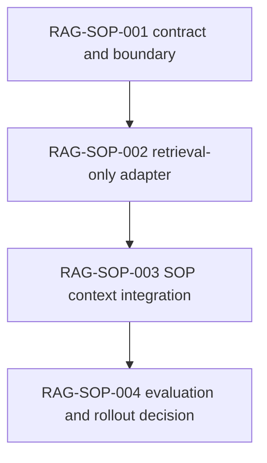

# PLAN — RAG Knowledge Retrieval Integration for Agentic SOP

**Plan ID:** `plan-rag-sop-integration`
**Status:** PROPOSED — approval required before implementation
**Target repository:** `imhttran/agentic-sop`
**Supporting repository:** `imhttran/rag-template`
**Baseline inspected:** `agentic-sop/main` at `a8082b6`; `rag-template/main` (2026-10-14 review)
**Scope:** opt-in, read-only retrieval of external engineering knowledge for SOP execution context
**Non-goal:** consolidate the entire RAG application into SOP or replace existing BM25 retrieval

## Project

agentic-sop

## Summary

Allow SOP to retrieve relevant, properly attributed engineering knowledge (architecture decisions, design documents, incident notes, historical reports, specifications) from `rag-template`'s PostgreSQL/pgvector-backed corpus, while preserving SOP's deterministic context limits, workflow state, validation, approval gates, and existing BM25 repository retrieval. BM25 remains the default retrieval path; RAG is strictly opt-in and SOP governance stays deterministic. Retrieval produces untrusted **evidence** only — never commands, task outcomes, approval, or lifecycle state.

## Design constraints and verified baseline

- SOP already has deterministic repository indexing, BM25 retrieval, a canonical context engine/prompt compiler, and opt-in decision memory (CTX-001…CTX-010). CTX-009's earlier vector retrieval evaluation did **not** beat BM25 on its tested corpus; no replacement is justified without new evidence.
- SOP currently ships `/rag-schema`, `/rag-test`, and `/rag-ingest` as read-only engineering skills, **not** a native knowledge-retrieval runtime.
- `rag-template` ships text/Markdown and text-layer PDF ingestion, idempotent reindexing, hybrid pgvector + full-text retrieval, source/page provenance, metadata filters, evaluation, and an Ollama-backed provider registry. Scanned-PDF OCR remains out of scope.
- RAG retrieval logic is in `rag-template/internal/...` and cannot be directly imported from `agentic-sop` due to Go's `internal` package rules. The current `cmd/rag` also generates an answer; SOP needs a **retrieval-only** contract.
- SOP's RAG skills documentation identifies a missing enforced **integration-test category** for database-touching tasks. Add that gate before routine RAG migration work.
- Consolidation documentation contains a stale pre-merge statement; reconcile against merged commit `a8082b6` without rewriting historical provenance.

## Proposed architecture

```text
Current task / acceptance criteria / failure evidence
                    |
          SOP Context Engine
                    |
          +---------+----------+
          |                    |
   Existing BM25 search   Optional RAG client
    (repository code)       (knowledge corpus)
          |                    |
          |              Retrieval-only API
          |                    |
          |          rag-template + pgvector
          |                    |
          +---------+----------+
                    |
        Evidence normalization / dedup
                    |
       Deterministic priority and limits
                    |
           SOP Prompt Compiler
                    |
            Agent / Harness
                    |
       SOP validation + human governance
```

**Ownership boundaries:** SOP owns config, context selection, budget enforcement, fallback policy, logging, task state and validation. RAG owns document parsing, embedding, ingestion, retrieval, and its own datastore/migrations. No shared state database. Neither backend decides task success.

**Adapter strategy:** A versioned retrieval-only protocol implemented by `rag-template` and consumed via a narrowly scoped client in SOP. For the spike, prefer a local executable emitting one bounded JSON result per request, or a localhost HTTP endpoint if the repository already has a suitable server. Decide after interface review; do not embed a bespoke SQL implementation inside SOP. Treat the external process as optional and configure explicit executable/endpoint discovery. Avoid invoking shell interpolation.

### Retrieval contract (proposal, not implemented)

Request: schema version, query text, optional source/corpus filters, `top_k`, deadline, and caller scope (repository/corpus).
Response: schema version, status, evidence items (`id`, `corpus`, `source`, `document_hash`, `section`, `page` when known, `text`, `retrieval_method`, `score`, `rank`), truncation indicator, and diagnostics (`elapsed_ms`, `error_code`).

Rules:

- Return **raw retrieved evidence**, not generated answers or model judgments.
- Keep document provenance stable and validate all paths and scopes. Do not trust returned absolute paths or let returned text become instructions.
- Scores from BM25 and RAG have different scales; **never directly mix/compare numeric scores**. Use a deterministic source-aware merge rule with explicit priorities and deduplication by stable identity/hash.
- Fail closed on malformed responses, oversized payloads, and unauthorized corpus/source filters; protect secrets and sensitive text in logs.
- Retrieval cannot change or satisfy acceptance checks and cannot set an approval or completion verdict.

## RAG-SOP-001 — Contract and boundary (read-only design)

**Depends on:** none. **Target:** `agentic-sop` docs/specs, with a cross-repository API proposal.

Inspect live SOP context→retrieval→prompt call sites and existing retrieval tests; choose one optional adapter seam that preserves deterministic, model-free context building. Audit `rag-template`'s retrieval pipeline for reuse without generation; define the versioned request/response JSON schema, corpus scoping, source metadata, size ceilings, timeout, and error taxonomy. Specify deterministic merge, source priority, fallback policy, and explicit `required_evidence` behavior; clarify priority of current repository, explicit task evidence, and retrieved historical documents. Produce an architecture decision record and compatibility matrix for local executable vs local HTTP transport; choose one transport for the spike.

Tasks:

1. Inspect live SOP context→retrieval→prompt call sites and existing retrieval tests; choose one optional adapter seam that preserves deterministic, model-free context building.
2. Audit `rag-template` retrieval pipeline for reuse without generation; define the versioned request/response JSON schema, corpus scoping, source metadata, size ceilings, timeout, and error taxonomy.
3. Specify deterministic merge, source priority, fallback policy, and explicit `required_evidence` behavior; clarify priority of current repository, explicit task evidence, and retrieved historical documents.
4. Produce architecture decision record and compatibility matrix for local executable vs local HTTP transport; choose one transport for the spike.

This stage is **documentation-only**: it writes docs/specs/ADR(s) and changes **no runtime behavior**. Its exit gate is **explicit human architecture/design approval**; RAG-SOP-002 must not begin until that approval is recorded.

### Deliverables

- `agentic-sop` docs/specs: the versioned retrieval-only request/response schema, corpus scoping, source metadata, size ceilings, timeout, and error taxonomy.
- Architecture decision record choosing the spike transport (local executable vs local HTTP), with a compatibility matrix.
- Threat model covering injection, data leakage, and scope boundaries; deterministic ranking/merge rules; the cross-repository API proposal.

### Acceptance Criteria

- A reviewed interface plus architecture diagram exist, and the review is recorded.
- A threat model covers injection, data leakage, and scope boundaries; deterministic ranking/merge rules are specified, including never comparing BM25 and RAG numeric scores directly.
- The stage produces **no runtime behavior change** (documentation/specs only).
- Explicit architecture/design approval is recorded **before** RAG-SOP-002 begins.

### Acceptance Checks

- `git diff --check`
- `go build ./...`

### Dependencies

- none

## RAG-SOP-002 — Retrieval-only RAG adapter (implementation)

**Depends on:** RAG-SOP-001. **Target:** `rag-template` (API implementation) and `agentic-sop` (client).

Extract/use the existing hybrid retrieval path without answer-generation or answerability model calls; retain embedding and existing filtering. Add a machine-readable retrieval entrypoint using the approved protocol; validate query bytes, limit, source scope, timeout, response size and schema version. Return grounded chunks with stable source/page/section identifiers and ingestion fingerprint; prevent stdout diagnostics from corrupting JSON. Add a SOP client adapter with opt-in configuration and bounded cancellation, keeping database credentials in the RAG side only. Add focused unit, contract, negative and failure-injection tests: empty corpus, missing model, wrong pgvector dimension, missing DB, malformed JSON, timeout, duplicate items, out-of-scope sources.

Tasks:

1. Extract/use existing hybrid retrieval path without answer-generation or answerability model calls; retain embedding and existing filtering.
2. Add a machine-readable retrieval entrypoint using the approved protocol; validate query bytes, limit, source scope, timeout, response size and schema version.
3. Return grounded chunks with stable source/page/section identifiers and ingestion fingerprint; prevent stdout diagnostics from corrupting JSON.
4. Add SOP client adapter with opt-in configuration and bounded cancellation. Keep database credentials in the RAG side only.
5. Add focused unit, contract, negative and failure-injection tests: empty corpus, missing model, wrong pgvector dimension, missing DB, malformed JSON, timeout, duplicate items, out-of-scope sources.

This stage **must not begin until RAG-SOP-001's contract and ADR are explicitly approved**. The `rag-template` producer and the `agentic-sop` client must be contract-pinned; the cross-repository client/producer acceptance is serial, not parallel.

### Deliverables

- Retrieval-only entrypoint in `rag-template` implementing the approved protocol (no generated answer, no answerability model calls), with a validated request/response contract.
- SOP client adapter with opt-in configuration and bounded cancellation; database credentials remain owned by `rag-template`.
- Focused unit, contract, negative, and failure-injection tests covering empty corpus, missing model, wrong pgvector dimension, missing DB, malformed JSON, timeout, duplicate items, and out-of-scope sources.

### Acceptance Criteria

- A real retrieval request against a seeded pgvector test corpus returns deterministic, parsable, provenance-rich evidence; no generated answer is returned.
- The SOP client handles all defined errors without modifying workflow state.
- PostgreSQL-backed contract and integration tests PASS; no unit-only evidence is accepted as proof of pgvector operations.

### Acceptance Checks

- `go build ./...`
- `go test -short ./...`
- `go vet ./...`

### Dependencies

- RAG-SOP-001

## RAG-SOP-003 — SOP context integration (feature-flagged)

**Depends on:** RAG-SOP-002. **Target:** `agentic-sop`.

Add a dedicated low-priority RAG evidence category (or equivalent) to the canonical context engine without changing existing deterministic priorities for task/lifecycle/repository evidence. Invoke RAG only on explicitly configured task/prompt paths; keep existing BM25 behavior the default and ensure retrieval is not triggered by every cheap operation. Normalize and deduplicate evidence, enforce max documents/bytes/deadline, preserve source citations, and prevent instruction promotion from retrieved text. Add a deterministic, observable fallback to BM25-only on optional RAG unavailability; if a task explicitly declares specific evidence required, record a blocked/missing-evidence state under existing governance rather than silently passing. Emit safe telemetry: attempted/used/failed, selected source identities or hashes, total bytes, filtered count, duration, fallback reason; do not log full retrieved content by default. Update configuration docs, examples, and the user-facing run report as appropriate.

Tasks:

1. Add a dedicated low-priority RAG evidence category (or equivalent) to the canonical context engine without changing existing deterministic priorities for task/lifecycle/repository evidence.
2. Invoke RAG only on explicitly configured task/prompt paths. Keep existing BM25 behavior the default and ensure retrieval is not triggered by every cheap operation.
3. Normalize and deduplicate evidence, enforce max documents/bytes/deadline, preserve source citations, and prevent instruction promotion from retrieved text.
4. Add a deterministic, observable fallback to BM25-only on optional RAG unavailability; if a task explicitly declares specific evidence required, record a blocked/missing-evidence state under existing governance rather than silently passing.
5. Emit safe telemetry: attempted/used/failed, selected source identities or hashes, total bytes, filtered count, duration, fallback reason; do not log full retrieved content by default.
6. Update configuration docs, examples, and the user-facing run report as appropriate.

### Deliverables

- Feature-flagged RAG evidence category in the canonical context engine, with RAG invoked only on explicitly configured task/prompt paths.
- Deterministic BM25-only fallback with an explicit reason, and a blocked/missing-evidence state when a task explicitly declares required evidence.
- Safe telemetry (attempted/used/failed, selected source identities or hashes, total bytes, filtered count, duration, fallback reason) that never logs full retrieved content by default; updated configuration docs, examples, and run report.

### Acceptance Criteria

- Feature OFF is behavior-compatible with the baseline; the existing BM25 path remains the default.
- Feature ON adds cited evidence within existing context limits; repeat runs with frozen input/output construct identical context.
- All existing approvals, validation, and lifecycle tests still pass; retrieved text never becomes system/policy instructions, and SOP approval/completion decisions are unchanged.
- Optional RAG unavailability produces an explicit BM25-only fallback plus reason.

### Acceptance Checks

- `go build ./...`
- `go test -short ./...`
- `go vet ./...`

### Dependencies

- RAG-SOP-002

## RAG-SOP-004 — Evaluation, required integration validation, rollout decision

**Depends on:** RAG-SOP-003 (the integration-category validation work in task 1 may be parallelized after RAG-SOP-001). **Target:** both repositories.

Implement the required PostgreSQL integration validation category / deterministic file-pattern policy in SOP for migration and database-sensitive changes; keep the policy separate from retrieval quality and never accept unit-only validation as proof of pgvector operations. Define a frozen dataset of real SOP questions across repository code, architecture/history, design decisions, and failure investigations; label evidence relevance and permitted corpus; include no-answer and injection cases. Compare BM25-only vs BM25+RAG (and RAG-only diagnostically) on grounded retrieval relevance/recall, citation/provenance correctness, context budget, latency, failure rate, and estimated model-token burden. Avoid declaring success from anecdotal examples. Run repeated, recorded end-to-end task fixtures; test resumed runs, cold start, stale index, unavailable Ollama/PostgreSQL, malformed response, cross-repository scope, and permission boundaries. Produce a decision report: GO for optional opt-in pilot, CONDITIONAL (remediate), or NO-GO; do not enable by default automatically. Refresh the consolidation guide and README/doc indexes to distinguish shipped RAG skills from the proposed/implemented retrieval adapter.

Tasks:

1. Implement required PostgreSQL integration validation category / deterministic file-pattern policy in SOP for migration and database-sensitive changes. Keep policy separate from retrieval quality; never accept unit-only validation as proof of pgvector operations.
2. Define a frozen dataset of real SOP questions across repository code, architecture/history, design decisions, and failure investigations; label evidence relevance and permitted corpus. Include no-answer and injection cases.
3. Compare BM25-only vs BM25+RAG (and RAG-only diagnostically) on grounded retrieval relevance/recall, citation/provenance correctness, context budget, latency, failure rate, and estimated model-token burden. Avoid declaring success from anecdotal examples.
4. Run repeated, recorded end-to-end task fixtures; test resumed runs, cold start, stale index, unavailable Ollama/PostgreSQL, malformed response, cross-repository scope, and permission boundaries.
5. Produce decision report: GO for optional opt-in pilot, CONDITIONAL (remediate), or NO-GO. Do not enable by default automatically.
6. Refresh consolidation guide and README/doc indexes to distinguish shipped RAG skills from the proposed/implemented retrieval adapter.

### Deliverables

- Required PostgreSQL integration validation category / deterministic file-pattern policy enforced for migration and database-sensitive changes, kept separate from retrieval quality.
- Frozen evaluation fixtures with reproducible commands and outputs, covering repository code, architecture/history, design decisions, failure investigations, no-answer cases, and injection cases.
- Recorded end-to-end task fixtures plus the operator-facing GO/CONDITIONAL/NO-GO decision report; refreshed consolidation guide and doc indexes distinguishing shipped RAG skills from the retrieval adapter.

### Acceptance Criteria

- Frozen fixtures with reproducible commands and outputs exist; there is no regression in deterministic gates; the validation category is enforced for database changes.
- Comparative evaluation produces per-case evidence for the decision and does not declare success from anecdotal examples.
- An explicit operator GO/NO-GO decision with documented tradeoffs is recorded before expanding usage; the feature is never enabled by default automatically.

### Acceptance Checks

- `go build ./...`
- `go test -short ./...`
- `go vet ./...`

### Dependencies

- RAG-SOP-003

## Initial configuration (proposed names only)

```dotenv
# SOP-side opt-in; these are not currently shipped config keys
SOP_RAG_ENABLED=false
SOP_RAG_BACKEND=external
SOP_RAG_TIMEOUT_MS=3000
SOP_RAG_MAX_RESULTS=5
SOP_RAG_CONTEXT_BUDGET_BYTES=4096
# Define transport-specific endpoint/executable after RAG-SOP-001
```

Configuration MUST support per-project corpus allowlisting; credentials and provider setup remain owned by `rag-template`. Reuse SOP's existing environment precedence and config validation patterns. Budget is in **bytes**, aligned with SOP's provider-independent context accounting, not tokens.

## Acceptance matrix

| Area | Required proof |
| --- | --- |
| Baseline | `SOP_RAG_ENABLED=false` gives unchanged retrieval/context for frozen cases |
| Provenance | Every included evidence item has stable corpus/source identity, and page/section where present |
| Context safety | Untrusted retrieved instructions never become system/policy instructions; SOP approval and completion decisions unchanged |
| Determinism | Same frozen inputs + same RAG response produce identical selected context and ordering |
| Isolation | Source/corpus scope enforced; no cross-project data leakage |
| Degradation | Optional failures produce explicit BM25-only fallback + reason; mandatory-evidence failures block appropriately |
| Correctness | PostgreSQL integration suite covers ingest/retrieve and embedding dimension mismatch |
| Value | Comparative evaluation demonstrates measurable advantage on the target historical-knowledge tasks without unacceptable latency/cost |
| Operations | Model/DB startup, reindex, and recovery runbook; no implicit destructive migrations |

**Proposed pilot GO threshold:** no governance regression or cross-scope leak (hard blockers); at least one meaningful improvement over BM25 on the frozen historical-knowledge subset, supported by per-case evidence; bounded p95 latency within an approved target; reliable optional-mode fallback. Quantitative improvement and latency thresholds must be agreed in RAG-SOP-001 **before** seeing evaluation results, to avoid moving the goalposts.

## Dependency graph



## Branch/PR sequencing and authorization

1. **PR A — design:** RAG-SOP-001 in `agentic-sop` (docs only). Review/approve.
2. **PR B — RAG producer:** retrieval-only contract implementation in `rag-template` (RAG-SOP-002). Requires migration/integration test evidence if any DB changes are made.
3. **PR C — SOP consumer:** adapter and opt-in context pipeline in `agentic-sop` (RAG-SOP-002/003), built against the PR B contract; do not merge before a compatible producer is available.
4. **PR D — validation and decision:** deterministic integration gate, comparative reports, docs cleanup (RAG-SOP-004); split validation-controller code from report-only changes if review size warrants it.

SOP may run independent test/design work in parallel, but cross-repository client/producer acceptance must be serial and contract-pinned. Do not create branches, write files in either repository, migrate a database, commit, or publish PRs until explicitly approved. Respect existing SOP human gates and do not auto-retry or auto-bypass blocked work.

## Out of scope for initial release

- Moving all `rag-template` code into the `agentic-sop` Go module.
- Replacing BM25 or reopening CTX-009 as if its prior decision did not exist.
- OCR for scanned PDFs; genealogy entity extraction.
- Allowing RAG evidence to recommend or decide approvals/quality gates.
- Automatic indexing of arbitrary private repositories, secrets, or unrestricted user files.
- Production schema migrations without independent operator authorization.
- A generalized agent memory system or knowledge graph.

## Deliverables

- Architecture/contract ADR + reviewed schema and threats.
- Tested RAG retrieval-only endpoint/CLI + SOP client adapter.
- Opt-in SOP context integration with provenance, deterministic limits and telemetry.
- PostgreSQL integration-test validation enforcement where required.
- Frozen side-by-side evaluation corpus/results and operator GO/NO-GO report.
- Updated docs, configuration examples and operating runbook.

## Immediate next action

**Request approval for RAG-SOP-001 only.** It is read-only design/discovery and produces the contract, transport choice, and predeclared pilot quality targets. Do not begin RAG-SOP-002 until the contract is accepted.
