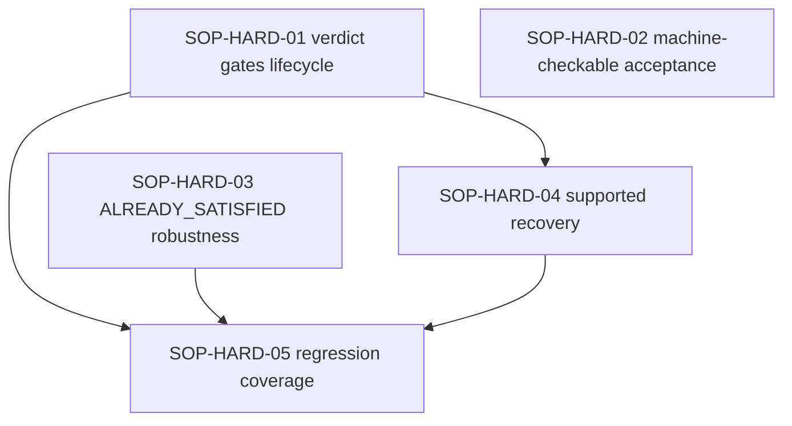

# PLAN — SOP Acceptance-Verification Hardening

**Type:** Correctness-hardening plan (verification, lifecycle gating, recovery). **Planning only — no runtime change.**
**Status:** IMPLEMENTED — integrated on `integration/sop-hardening` (based on `main` @ `c54eef3`). See the completion section at the end.
**Baseline:** `agentic-sop` `main` @ `3be4a90`.
**Derived from:** observed RAG-023/RAG-024/RAG-025 runs (SOP PASS + outcome `PARTIAL`; `ALREADY_SATISFIED` rejected with 0 mutations; a missing deliverable still reaching `LOCAL_DONE`).
**Does not** change any production RAG behaviour; it hardens SOP's own acceptance verification.

## Project
agentic-sop

## Summary

SOP's outcome verifier already distinguishes `VERIFIED`/`PARTIAL`/`HOLD`, checks deliverables, and runs operator-declared acceptance **checks** — but the verdict never affects the lifecycle, machine-checkable acceptance is opt-in/undiscovered, `ALREADY_SATISFIED` is unreachable for an already-complete implementation, and there is no supported recovery. This plan makes the verdict a lifecycle input (gated + waivable), makes machine-checkable acceptance the default, hardens `ALREADY_SATISFIED`, and adds supported recovery — with deterministic, executable acceptance checks and regression coverage for the RAG-025 scenarios.

## Pinned operator decisions (2026-10-12)

1. **Gating default-off.** Acceptance gating is **initially default-off** and enabled **only by explicit operator configuration** (no automatic flip).
2. **Migration warnings.** Missing `Acceptance Checks` generate **warnings** during migration. **Required deliverables remain enforceable** once gating is enabled.
3. **Waivers.** Only **designated approvers** may grant **criterion-scoped** waivers. A waiver requires **reason, attribution, timestamp, and durable append-only audit evidence**.
4. **Environment-unavailable validation.** Requires **explicit waiver approval**; it is **never silently bypassed**.
5. **Gating scope.** Only **required deliverables** and **required executable checks** gate `LOCAL_DONE`. **Informational criteria do not.**
6. **Backward compatibility.** Existing plans and historical archives remain loadable and are never rewritten.

## Root-cause analysis (source-grounded)

1. **`PARTIAL` never blocks `LOCAL_DONE`.** `internal/cli/run.go:283-287`: the outcome field “distinguishes PASS/LOCAL_DONE from verified completion and **never changes the lifecycle transition**.”
2. **Prose criteria are unverifiable by construction.** `internal/outcome/outcome.go:88-96` sets `Evidence = "unverifiable: no deterministic check supplied"` when `Check == nil`; `Verify` returns `PARTIAL` if a `Required` criterion is unmet or none is declared (`:76-95`). `internal/cli/outcome.go:156-195` makes free-text `AcceptanceCriteria` Required+unverifiable and adds a required `objective-acceptance` when a stage declares no `AcceptanceChecks`.
3. **A machine-checkable route exists but is opt-in/undiscovered.** `internal/planner/markdown.go:164-166` maps an `### Acceptance Checks` subsection to `spec.AcceptanceChecks` (exact commands, classified by `internal/commandpolicy`, executed directly at `internal/cli/outcome.go:119-232`). RAG-023/024/025 plans declared only `### Acceptance Criteria`, so every run fell through to the unverifiable branch.
4. **`ALREADY_SATISFIED` fails closed too hard.** `internal/ollamaagent/already_satisfied.go:57-104` accepts a no-mutation claim only when the evidence `Acceptance` list length **exactly equals** `len(req.AcceptanceCriteria)`, every criterion maps to an inspected file, **every** `req.ValidationCommands` actually executed in-process, and the repository fingerprint is unchanged. A sandbox-unrunnable validation or a prose-criteria mismatch → reject → `CONTINUE` → re-narrate → `FIX_NO_PROGRESS` (`orchestrate.go:394-396,790`).
5. **Deliverable existence is verified but non-gating.** `internal/cli/outcome.go:92-104` stats deliverable paths as `Required` and yields `PARTIAL` when one is missing — yet per (1) the task still reaches `LOCAL_DONE` (RAG-025E: missing `docs/operations/platform-support.md`, still `PASS`).
6. **No supported re-verification of a `LOCAL_DONE` task.** Only `sop reconcile` (a *definition* change; `--accept-changed` for executed) and `sop retry` (`BLOCKED` only); operators recover by hand.
7. **Gate ≠ objective.** The gate is build/vet/lint + review; a docs-only stage passes trivially, and the (non-gating) outcome verifier is the only thing that checks the declared deliverable.

## Acceptance-checks syntax (verified)

`### Acceptance Checks` items are split into an argv (never a shell) by `toolharness.SplitCommand`, rejected if dangerous (`go fmt`, `-exec/-toolexec/-vettool/-o/-overlay/-modfile`, git config injection), then classified by `internal/commandpolicy` (`internal/cli/outcome.go:216-232`). `go build|test|vet|list` (any package list, incl. `./...` and `-race`) are **SAFE**; read-only `git diff|status|log|show|rev-parse|…` are SAFE. **Every `### Acceptance Checks` command in this plan uses only SAFE, executable forms.**

## Lifecycle semantics (pinned)

Gating applies **only when enabled by explicit operator configuration** (decision 1). When enabled:

| Outcome verdict | Gate | Lifecycle (gating on) |
| --- | --- | --- |
| `VERIFIED` | PASS | `LOCAL_DONE` |
| `PARTIAL` from an unmet **required deliverable** or **required executable check** | PASS | **block** `LOCAL_DONE` → `NEEDS_HUMAN`, unless a designated-approver waiver names each unmet criterion |
| `PARTIAL` from unmet **informational** criteria only | PASS | `LOCAL_DONE` (informational criteria do not gate — decision 5) |
| `HOLD` (boundary crossed) | any | `NEEDS_HUMAN` |
| gate `FAIL`/`BLOCKED` | FAIL | `BLOCKED`/`NEEDS_HUMAN` |
| valid waiver recorded for every unmet **required** criterion | PASS | `LOCAL_DONE`, waiver surfaced in report + archive |

When gating is **off** (default), the lifecycle is byte-identical to today; the verdict is reported only.

## Waiver record (pinned schema — HARD-04)

Granted **only by a designated approver**. Required fields: `task`, `criterion_id`, `scope` (deliverable path or check id), `reason`, `approver` (attribution), `recorded_at` (timestamp), and the waived `outcome`. Persisted as **durable, append-only audit evidence** in the run artifact **and** the plan archive; surfaced by `sop report`/`sop status`. A waiver is **criterion-scoped** and never implied. Environment-unavailable validation commands require such a waiver; they are **never silently bypassed** (decision 4).

## Recovery for a `LOCAL_DONE` task with incomplete acceptance (HARD-04)

- `sop verify <task>` — **read-only**: recompute the outcome verdict from the spec and print per-criterion results; **no** lifecycle transition.
- `sop outcome --waive <criterion> --reason R --by NAME` — record a designated-approver waiver so a legitimate `LOCAL_DONE` is explicit.
- **Never rewrite historical outcomes:** the original `PARTIAL` verdict and report are preserved; a waiver is an appended record. `sop reconcile` still requires `--accept-changed` for executed tasks; archives are never edited.

## SOP-HARD-01 — Verdict gates the lifecycle (operator-enabled; waivable)

Gate `LOCAL_DONE` on the outcome verdict per the pinned lifecycle semantics, behind an operator-enabled flag and waivable by a designated approver.

### Deliverables
- `internal/cli/run.go`, `internal/cli/outcome.go`, `internal/outcome/outcome.go`, `internal/config/config.go` — the lifecycle table, behind an **operator-enabled** flag (default off).
- `docs/reference/` — the semantics and the flag.

### Acceptance Criteria
- With the flag **off** (default), the lifecycle is unchanged.
- With the flag **on**, a `PARTIAL` from an unmet required deliverable/check does not yield `LOCAL_DONE` unless a valid waiver exists; informational-only `PARTIAL` and `HOLD` behave as specified.

### Acceptance Checks
- `go test ./internal/outcome/... ./internal/config/...`
- `go test ./internal/cli/... -run ApplyLifecycleGate`
- `go vet ./internal/outcome/... ./internal/cli/...`

### Dependencies
- none

## SOP-HARD-02 — Machine-checkable acceptance (surfacing + migration warnings)

Surface `Acceptance Checks` in plan authoring and warn (never hard-fail) during migration when a stage declares deliverables without any executable check.

### Deliverables
- `internal/planner/markdown.go` (surface `Acceptance Checks`; **warn** when a stage declares deliverables without checks) and an authoring lint; `docs/` guidance.

### Acceptance Criteria
- A stage with deliverables and no acceptance checks yields a clear **warning** (never a hard failure during migration — decision 2).
- Existing plans without checks remain loadable; the RAG-025 plan family is flagged.
- Required deliverables remain enforceable once gating is enabled.

### Acceptance Checks
- `go test ./internal/planner/...`
- `go vet ./internal/planner/...`

### Dependencies
- none

## SOP-HARD-03 — `ALREADY_SATISFIED` robustness (no mutation required) + validation waiver

Let `ALREADY_SATISFIED` accept independently verified existing work with zero repository mutations, with an explicit approver waiver for environment-unavailable validations.

### Deliverables
- `internal/ollamaagent/already_satisfied.go`, `internal/ollamaagent/orchestrate.go` — index/normalized criterion matching; accept independently verified existing work with **zero** repository mutations; explicit **approver waiver** for an environment-unavailable validation command (decision 4).

### Acceptance Criteria
- An existing, independently verified implementation is accepted with **no mutation required**.
- A validation command the environment cannot run requires an explicit approver waiver; it is never silently bypassed.
- A no-evidence or fabricated claim is still rejected; an unchanged repository fingerprint remains mandatory.

### Acceptance Checks
- `go test ./internal/ollamaagent/...`
- `go vet ./internal/ollamaagent/...`

### Dependencies
- none

## SOP-HARD-04 — Supported recovery (`sop verify`, `sop outcome --waive`) + waiver audit

Add a read-only `sop verify` and a designated-approver `sop outcome --waive`, with criterion-scoped, attributed, timestamped, append-only audit records.

### Deliverables
- `internal/cli/` — read-only `sop verify <task>`; `sop outcome --waive` (designated approvers only; schema above; durable append-only audit); `docs/reference/`.

### Acceptance Criteria
- `sop verify` performs no state transition and prints the per-criterion verdict.
- Only a designated approver can waive; every waiver records reason + attribution + timestamp + append-only audit and is surfaced; none is silently applied.
- `sop retry` (`BLOCKED`) semantics unchanged; archives never rewritten.

### Acceptance Checks
- `go test ./internal/cli/...`
- `go vet ./internal/cli/...`

### Dependencies
- SOP-HARD-01

## SOP-HARD-05 — Regression coverage for the RAG-025 scenarios

Add deterministic regression tests for the RAG-025A/B/C/E scenarios that fail on the pre-hardening behaviour and pass after.

### Deliverables
- Deterministic fixtures/tests, each mapping to an observed RAG-025 scenario:
  - **RAG-025A** (deliverables present; prose criteria): a `PARTIAL` from unverifiable criteria does not gate when informational; deliverable checks pass.
  - **RAG-025B** (`ALREADY_SATISFIED`, 0 mutations, evidence present): accepted under HARD-03; rejected when evidence is missing.
  - **RAG-025C** (environment-unavailable validation): requires an explicit approver waiver; never a silent pass.
  - **RAG-025E** (required deliverable absent, gate PASS): `PARTIAL`; with gating on, **no** `LOCAL_DONE`.
- Audit-history assertions (verdict + waiver persisted; archive unchanged).

### Acceptance Criteria
- Each scenario has a deterministic test that **fails on the pre-hardening behaviour** and passes after.
- The tests run in the standard `go test ./...` suite (no external infra).

### Acceptance Checks
- `go test ./...`
- `go test -race ./...`

### Dependencies
- SOP-HARD-01
- SOP-HARD-03
- SOP-HARD-04

## Dependency graph

## Concurrency and file ownership

- **Independent (parallel):** SOP-HARD-02 (`internal/planner/**`) and SOP-HARD-03 (`internal/ollamaagent/**`).
- **Shared-file risk:** SOP-HARD-01 and SOP-HARD-02 both plausibly edit **`internal/config/config.go`** (the gate flag for 01; the warning knob for 02) — **do not run them concurrently on that file**; land 02 first, then 01, or serialize the `config.go` edits.
- **Serialized:** SOP-HARD-04 after 01 (both touch `internal/cli`); SOP-HARD-05 after 01/03/04.
- Use isolated worktrees; never run concurrent SOP state transitions on one plan.

## Risks

- **Behaviour change:** gating `PARTIAL` may block previously-passing docs-only tasks — mitigated by default-off + operator enablement + waivers + landing HARD-02 first.
- **Verification loosening:** HARD-03 and the validation waiver must stay fail-closed — every waiver explicit, approver-attributed, scoped, reasoned, timestamped, audited.
- **Back-compat:** existing plans load (warnings only); archives are never rewritten.

## Compatibility

- Plans without `### Acceptance Checks` remain loadable (warnings only); `.agent-sdlc/archive/` is read-only and untouched.
- Default (gating off) reproduces today's lifecycle exactly.

## Recommended execution order

1. **SOP-HARD-02** (surface machine-checkable acceptance; migration warnings).
2. **SOP-HARD-01** (operator-enabled gating; waiver).
3. **SOP-HARD-03** (`ALREADY_SATISFIED` robustness).
4. **SOP-HARD-04** (supported recovery), then **SOP-HARD-05** (regression coverage).

This plan is **PROPOSED**: do not activate, implement, commit, or push until the operator approves.

## Completion status (integrated)

All five requirements are implemented and integrated onto `main`: SOP-HARD-01 lifecycle verdict gate (`lifecycle.verdict_gate`, default off); SOP-HARD-02 executable acceptance checks preserved on `main` + authoring lint (`internal/planner/lint.go`); SOP-HARD-03 verified `ALREADY_SATISFIED` preserved on `main` + normalized matching/evidence-only correction/structured rejections; SOP-HARD-04 `sop verify` + `sop outcome --waive` (designated-approver, criterion-scoped, append-only audit); SOP-HARD-05 RAG-025 regression coverage. Full `go test ./...` green.
