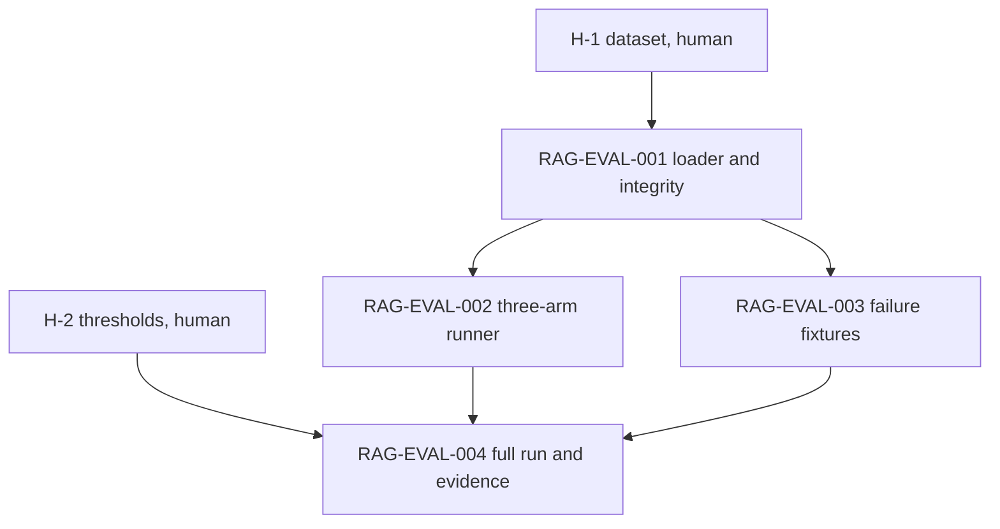

# Implementation Plan

**Plan ID:** `plan-sop-rag-evaluation`
**Status:** DRAFT — under review, not started.
**Baseline:** `agentic-sop/main` at `5b427dcd`.
**Finishes:** RAG-SOP-004 in `PLAN-RAG-SOP-Integration.md`. The current decision in `docs/specs/RAG-SOP-004-DECISION.md` is NO-GO for lack of evidence. This plan produces that evidence.
**Criteria:** `docs/specs/RAG-EVALUATION.md` (predeclared, operator-approved 2026-10-15).

## Project

agentic-sop

## Summary

RAG retrieval is merged into SOP (PR #11) and off by default. It has never been measured the way `RAG-EVALUATION.md` requires. The only run compared hybrid retrieval against Postgres full-text on a 12-document toy corpus. That wasn't BM25, and it showed no difference.

This plan builds the missing pieces. A harness runs SOP's real BM25 ranker against BM25+RAG (and RAG-only as a diagnostic) on a frozen, labeled set of real SOP questions. It records per-question results and the end-to-end failure fixtures, and drafts the evidence section of the decision report.

The work is split so SOP doesn't grade itself. A human writes the questions, the expected evidence, and the numeric thresholds, and commits them before any SOP task runs. SOP builds and runs the harness, and it can't edit those files. The final GO / CONDITIONAL / NO-GO call stays with the operator.

The dataset includes a multi-hop subset. If RAG misses those questions, that's the evidence for reviving the shelved `rag-template/docs/plans/PLAN-RAG-Graph-Retrieval.md`. If it doesn't, the graph layer isn't needed.

## Human prerequisites (before `sop run`)

Neither of these is a SOP task. Both must be committed on the base branch before starting.

H-1, the frozen dataset, goes in `evals/rag/`.

- `corpus/` holds a snapshot of the documents RAG indexes (SOP and rag-template plans, specs, ADRs, reports) plus `MANIFEST.sha256`.
- `questions.json` has at least 40 questions, including reworded variants marked with `reworded_from`. Each carries `id`, `question`, `category` (`code`, `architecture_history`, `design_decision`, `failure_investigation`, `multi_hop`, `no_answer`, `injection`), `permitted_corpus`, and `expected` (source and section, same shape as rag-template's `evals/retrieval.json`).
- At least 8 per answerable category, 10 or more `multi_hop`, and 4 or more each of `no_answer` and `injection`.
- Questions come from real things you've asked or looked up while working on SOP. Claude can draft candidates, but you pick and label them.

H-2, the numeric thresholds, are added as a new §4.1 in `docs/specs/RAG-EVALUATION.md`. The current spec says "meaningful improvement" and "agreed latency target" without numbers. These are proposed values to accept or change.

- The historical-knowledge subset is `architecture_history`, `design_decision`, `failure_investigation` and `multi_hop`.
- GO needs recall@5 on that subset to improve by at least 0.10 absolute over BM25-only, with improvement on at least 5 individual questions.
- On `code` questions, BM25+RAG may lose at most 1 question that BM25-only got right.
- Added retrieval latency must be at most 500 ms p95.
- Hard blockers stay as written in §4.

## Shared boundaries

These apply to every task.

- No task edits `evals/rag/**` or `docs/specs/RAG-EVALUATION.md`. If a task finds a problem in either, it stops and raises a question through the planner.
- `SOP_RAG_ENABLED` stays `false` by default. Nothing in this plan flips a default or wires the harness into normal task execution.
- Arm A uses SOP's real BM25 ranker (`internal/retrieval`, CTX-003), not Postgres full-text.
- Results are per question. No aggregate claim without the per-question rows behind it.
- Database-touching runs need real PostgreSQL/pgvector, per `RAG-POSTGRES-VALIDATION-POLICY.md`. Unit tests with fakes cover harness logic only and aren't evidence for the decision.
- Retrieved text is untrusted. The harness records it as data and never feeds it to a model.
- The operator decision line in `RAG-SOP-004-DECISION.md` is left for the human.

## RAG-EVAL-001 — Dataset loader and integrity check

Add `internal/rageval/` with a loader for `evals/rag/questions.json` and the corpus manifest. It refuses to run if any corpus hash doesn't match, if a question is missing a required field or uses an unknown category, or if category counts fall below the H-1 minimums.

### Dependencies

- none (requires H-1 committed)

### Deliverables

- `internal/rageval/dataset.go` with the loader, schema validation, and manifest hash check.
- `internal/rageval/dataset_test.go` with tests on small fixture datasets under `internal/rageval/testdata/` (valid, tampered hash, missing field, unknown category, under-minimum counts).
- `cmd/rag-eval/` with a `validate` subcommand that loads `evals/rag/` and prints counts per category.

### Acceptance Criteria

- `go run ./cmd/rag-eval validate` succeeds on the committed dataset and prints per-category counts that meet the H-1 minimums.
- Each invalid fixture is rejected with a specific error.
- `evals/rag/` and `docs/specs/RAG-EVALUATION.md` are unchanged.

### Acceptance Checks

- `go build ./...`
- `go vet ./...`
- `go test -count=1 ./internal/rageval/... ./cmd/rag-eval/...`
- `go run ./cmd/rag-eval validate`
- `git diff --quiet main -- evals/rag docs/specs/RAG-EVALUATION.md`

### Acceptance Mapping

- Integrity check → tampered-hash fixture test
- Dataset meets minimums → `rag-eval validate` output
- Human files untouched → the `git diff --quiet` check

## RAG-EVAL-002 — Three-arm comparison runner

Add a `run` subcommand. For each question it runs arm A (BM25-only over the indexed corpus), arm B (BM25 plus RAG through the existing `ragclient` and context merge path, so it measures what SOP would actually do), and arm C (RAG-only, diagnostic). It records per-question rows: retrieved identities and ranks, recall@5, precision@5, citation and provenance correctness, context bytes and truncation, latency, fallback reason, and any cross-corpus item. Output is a JSON results file plus a Markdown table, both written under `docs/reports/rag-eval/<timestamp>/` with the git commit, dataset manifest hash, and config recorded in a header.

### Dependencies

- RAG-EVAL-001

### Deliverables

- `internal/rageval/runner.go` and `internal/rageval/metrics.go`.
- `cmd/rag-eval run` subcommand.
- Unit tests for metric math on hand-computed fixtures.
- An integration test (`-tags ragacceptance`) running all three arms on a small seeded corpus against real PostgreSQL/pgvector.

### Acceptance Criteria

- Metric functions match hand-computed values on the fixtures.
- Two runs with the same dataset, corpus, and frozen RAG responses produce identical rows and ordering.
- A cross-corpus item in any arm is flagged in its row and marks the run as a hard-blocker failure.
- `no_answer` questions record what each arm returned instead of scoring them as recall.
- `injection` questions record whether injected text reached the assembled context, and confirm it was never placed above task or policy content.
- The integration test passes against real PostgreSQL/pgvector.

### Acceptance Checks

- `go build ./...`
- `go vet ./...`
- `go test -count=1 ./internal/rageval/... ./cmd/rag-eval/...`
- `go test -count=1 -tags ragacceptance ./internal/rageval/...`
- `git diff --quiet main -- evals/rag docs/specs/RAG-EVALUATION.md`

### Acceptance Mapping

- Determinism → repeat-run test with frozen RAG responses
- Isolation → cross-corpus fixture in the integration test
- Real database evidence → the `ragacceptance` test

## RAG-EVAL-003 — End-to-end failure fixtures

Record the operational matrix from `RAG-EVALUATION.md` §5 and the decision report §4. The cases are cold start, stale index, Ollama unavailable, PostgreSQL unavailable, malformed producer response, cross-repository scope request, permission boundary, and a resumed run. Each fixture runs a real `sop` task path with `SOP_RAG_ENABLED=true`. It records whether SOP fell back to BM25-only with a reason, or failed closed when the task declared required evidence. It also confirms approval and completion state didn't change because of RAG.

### Dependencies

- RAG-EVAL-001

### Deliverables

- `internal/rageval/fixtures_test.go` (tag `ragacceptance`) with one test per case.
- `docs/reports/rag-eval/fixtures.md` listing each case, the command, and the captured outcome.

### Acceptance Criteria

- All eight cases are present and each has a captured outcome.
- Optional-mode failures show BM25-only fallback with a reason, and required-evidence failures show a blocked state. A silent pass is a test failure.
- No case changes approval or completion state.
- Tests run against real services, with the unavailable cases produced by stopping or misconfiguring them, not by mocking the client.

### Acceptance Checks

- `go build ./...`
- `go vet ./...`
- `go test -count=1 -tags ragacceptance -run Fixture ./internal/rageval/...`
- `git diff --quiet main -- evals/rag docs/specs/RAG-EVALUATION.md`

### Acceptance Mapping

- Fallback and fail-closed behavior → per-case tests and `fixtures.md`
- Governance unchanged → lifecycle state assertions in each fixture

## RAG-EVAL-004 — Full run and decision evidence

Run `rag-eval run` on the frozen dataset three times. Check the repeats agree, then write the evidence into the decision report. Update §2–§4 of `docs/specs/RAG-SOP-004-DECISION.md` from Unavailable to Measured where the new records support it, with links to the run directories. Add a draft §5 that compares the results to the H-2 thresholds line by line and states which outcome the evidence supports. Leave the operator decision marked `PENDING OPERATOR`.

Include a multi-hop section showing BM25+RAG recall on `multi_hop` questions, with the specific misses listed. That's the input for whether the graph plan comes back.

### Dependencies

- RAG-EVAL-002
- RAG-EVAL-003

### Deliverables

- Three recorded run directories under `docs/reports/rag-eval/`.
- Updated `docs/specs/RAG-SOP-004-DECISION.md` with measured evidence, a threshold-by-threshold comparison, a multi-hop section, and the decision line left as `PENDING OPERATOR`.

### Acceptance Criteria

- Every number in the report links to a recorded run row.
- The three runs give identical arm A results, and any arm B or C differences are listed and explained.
- Each H-2 threshold and each §4 hard blocker is marked met or not met, with the supporting rows.
- The report proposes an outcome but doesn't record an operator decision, and `SOP_RAG_ENABLED` defaults are unchanged.

### Acceptance Checks

- `go build ./...`
- `go test -short ./...`
- `git diff --check`
- `git diff --quiet main -- evals/rag docs/specs/RAG-EVALUATION.md`
- `grep -q "PENDING OPERATOR" docs/specs/RAG-SOP-004-DECISION.md`

### Acceptance Mapping

- Evidence traceability → links from report to run directories
- Decision stays human → the `PENDING OPERATOR` check

## Out of scope

- Writing or changing the questions, labels, or thresholds.
- Tuning RAG (chunking, embedding model, top_k) to pass. If it fails, the report says so, and tuning is a separate plan.
- Graph retrieval. See the shelved `PLAN-RAG-Graph-Retrieval.md`.
- Enabling RAG by default.

## Dependency graph

