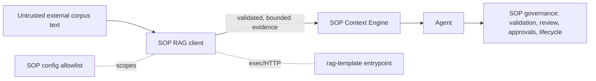

# RAG Retrieval Integration — Security Threat Model

**Type:** Security specification / threat model (RAG-SOP-001 deliverable).
**Status:** APPROVED (architecture) — operator-approved 2026-10-15 for RAG-SOP-002 implementation (documentation record; not a SOP lifecycle approval).
**Plan:** [`docs/plans/PLAN-RAG-SOP-Integration.md`](../plans/PLAN-RAG-SOP-Integration.md).
**Related:** [architecture](../architecture/RAG-RETRIEVAL-INTEGRATION.md),
[contract](RAG-RETRIEVAL-CONTRACT.md), [configuration](RAG-CONFIGURATION.md).

## 1. Assets

- SOP task/lifecycle/approval state (the authority that MUST NOT be influenced by
  retrieved data).
- Repository and corpus confidentiality (no cross-project leakage; no secrets logged).
- Determinism of the Context Engine and the lifecycle.
- The `rag-template` datastore and credentials.

## 2. Trust boundaries

The **only** untrusted input crossing into SOP is retrieved evidence text plus validated
metadata. Everything else (task, repository, execution, recovery, memory, RAG evidence) is
data to the agent; only SOP's deterministic engines decide outcomes.

## 3. Threats and mitigations

| # | Threat | Mitigation (design) |
| --- | --- | --- |
| T1 | **Prompt injection** — retrieved text impersonates system/policy instructions | Retrieved items are labelled `SourceKnowledgeRAG` evidence at the lowest priority; never merged into system/policy; the prompt compiler presents them as quoted, attributed, untrusted evidence. No acceptance check or gate reads them. |
| T2 | **Cross-corpus data leakage** | Corpus is the isolation unit (D2): a new `documents.corpus` column, an operator **trusted allowlist** (`SOP_RAG_ALLOWED_CORPORA`), and a **pre-filter** applied in both keyword and vector retrieval before ranking and limits. Legacy NULL-corpus rows are never returned (equality predicate). SOP also validates the returned `corpus`; a mismatch is `UNAUTHORIZED_SCOPE` and the whole response is dropped. |
| T3 | **Secret / sensitive-text leakage into logs** | RAG logs record counts, identities/hashes, bytes, durations, and reasons — never full retrieved content by default. `INTERNAL` diagnostics are secret-free. |
| T4 | **Path/provenance abuse** — absolute paths or traversal in `source` | `source` is validated to a stable relative identity; absolute paths and traversal are rejected; only `document_hash` + `source` + `section` are treated as identity. |
| T5 | **Resource exhaustion / DoS** | Byte ceilings on query, chunk, and whole response; `top_k` cap; hard deadline; process kill on timeout; RAG never called from cheap operations. |
| T6 | **SSRF / network exposure** (HTTP transport) | Not used in the spike (local executable, no socket). If HTTP is later adopted, it is loopback-only with a fixed, configured endpoint. |
| T7 | **Malformed response corruption** | Strict JSON parse; any malformed/oversize response is dropped whole (`MALFORMED`/`OVERSIZE`); stdout diagnostics are forbidden (logs go to stderr). |
| T8 | **Silent trust of unavailable evidence** | Optional failures fall back to BM25 with an explicit reason; explicitly **required** evidence fails closed (blocked/missing-evidence) rather than passing. |
| T9 | **Score conflation** — treating vector similarity as BM25-equivalent | Scores are never compared across engines; SOP merges by source-aware priority only. |
| T10 | **Governance bypass** — RAG nudging approval/completion | Retrieval is read-only evidence; it cannot satisfy acceptance checks, set approval, or change lifecycle. Approval/quality gates remain SOP-owned and deterministic. |
| T11 | **Credential exposure via SOP** | DB/provider credentials stay in `rag-template`'s environment; SOP config carries only the executable/endpoint and allowlists. |
| T12 | **Non-determinism** | Same frozen inputs + same RAG response ⇒ identical selected context and ordering (Context Engine total order); RAG output is bounded and normalized before selection. |
| T13 | **Answer-generation contamination** — a "retrieval" path that secretly generates or reranks answers | The initial adapter MUST NOT import `cmd/rag`, `internal/rag`, `internal/answerability`, `internal/generation`, or `internal/reranking`; it uses `internal/retrieval` only and returns raw evidence with no generated/verdict fields (contract §10). |

## 4. Fail-closed rules

1. Unknown `schema_version` → reject; never best-effort parse.
2. Scope/allowlist violation → reject the whole response; never widen.
3. Oversize/malformed → reject the whole response; never partial-parse.
4. Required-evidence unavailable → blocked/missing-evidence, never a silent pass.
5. RAG disabled (default) → the code path is not exercised; behaviour is byte-identical to
   the baseline.

## 5. Open risks / assumptions

- **R1 (resolved to a task):** `documents.content_hash` exists but is **not** on the retrieval
  read path; RAG-SOP-002 MUST project it into the retrieval `SELECT`s and
  `retrieval.Document` (contract §5). Legacy rows have NULL → empty `document_hash`, tolerated
  but never used as a dedup identity against a hashed item.
- **R2 (resolved to a task):** `documents.corpus` does **not** exist today; it is added by the
  backward-compatible migration (contract §8). Until an explicit backfill, legacy rows are
  unretrievable by corpus — fail closed, not a leak.
- **R3:** the local-executable transport removes T6 in the spike but adds process-spawn
  controls (executable path validation, no shell) — enforced by the contract.
