# DME decision-model evaluation — rerun 2026-10-13

Rerun of the frozen 61-scenario decision-model corpus
(`../corpus.json`, sha256 `9937cc4631de40c78430a160ae034045c07d14d687a2cee90d54b0ad13111e77`)
and an independent reconciliation against the frozen results. These are **new
artifacts only**: the frozen `../*.results.json` files, the corpus, the labels, the
prompts, and the scoring definitions were not modified.

Status: descriptive evidence. Reviewed and recomputed; **no production behavior,
routing, or policy was changed**, and no AI layer was enabled as a governance authority.

## Provenance

- Repository revision: `a5757dc` (branch `main`); clean working tree at rerun.
- Date: 2026-10-13.
- Corpus freeze verified before running:
  `go test ./internal/deceleval/ -run TestRepoCorpusLoadsValidatesAndIsFrozen` → PASS.
- Harnesses: `internal/deceleval`; commands `cmd/deceleval-{baseline,advisory,jev}`.
- Local backend: Ollama `0.40.3`, default base URL `http://localhost:11434`.
  Models present: `clef-flash:latest` (`0a2a05d6a581`), `nimble:latest` (`24e550a16a70`),
  `glm-4.7-flash:latest` (`5c61808ebf0d`).
- Advisory adapter: `/tmp/sop-decision-adapter` (the external `sop-decision-adapters`
  CLI), invoked by the connector as
  `decide -file <request.json> -json -provider clef -timeout 120s` — no `-model` is
  passed, so the adapter's own default model applies.
- Deterministic Go remains the execution-governance authority. CLEF, Nimble, and JEV
  were **not** enabled as governance authorities; Muse Glimmer was not added.

## Commands executed

```sh
go run ./cmd/deceleval-baseline \
  -out evals/decision-model/rerun-2026-10-13/baseline-A.results.json

env CLEF_ENABLED=1 go run ./cmd/deceleval-advisory \
  -adapter /tmp/sop-decision-adapter -adapter-provider clef \
  -out evals/decision-model/rerun-2026-10-13/paired-A-B.results.json

env SOP_OLLAMA_MODEL=glm-4.7-flash:latest SOP_OLLAMA_TIMEOUT=180s \
  go run ./cmd/deceleval-jev \
  -out evals/decision-model/rerun-2026-10-13/jev-shadow.results.json
```

## Artifacts and checksums

| File                      | sha256                                                             | vs frozen      |
| ------------------------- | ------------------------------------------------------------------ | -------------- |
| `baseline-A.results.json` | `3eef963e71aab6a3348087d8c1a1366fd66c96a557af140b964776adf58362f1` | byte-identical |
| `paired-A-B.results.json` | `6d733f0915bcca7b4f561abe834d490eca5651384642b28c0d671c78f479f057` | differs        |
| `jev-shadow.results.json` | `9ae0006939730615ad4073b7941d26f21748a14747806b1b5a983f612dbbb979` | differs        |

Frozen references: `baseline-A` `3eef963e…`, `paired-A-B` `bd6e419d…`,
`jev-shadow` `901306bb…`.

## Independent verification

Every reported metric was recomputed from the raw records of all six artifacts
(frozen and rerun × baseline/paired/jev), using the same definitions as
`internal/deceleval` (attention = `NEEDS_HUMAN`; advisory metrics over consulted,
non-fixture records; JEV metrics over `actionable` records; nearest-rank percentiles).
**All recomputed values matched the reported `metrics` blocks exactly**, and the corpus
sha256 matched `../CORPUS.sha256`. `cmp` confirmed the rerun baseline is byte-identical
to the frozen baseline.

## Results comparison (frozen → rerun)

| Metric                                 | Deterministic Go        | CLEF/Nimble advisory (change-risk)              | JEV shadow (hypothetical)                                   |
| -------------------------------------- | ----------------------- | ----------------------------------------------- | ----------------------------------------------------------- |
| Evaluated / coverage                   | 61/61 (both)            | 61 paired, 32 consulted, 29 not eligible (both) | 61/61 available (both)                                      |
| Exact failure-disposition agreement    | 47/61 (both, identical) | 40/61 → 39/61                                   | 8/61 → 11/61                                                |
| Operational agreement ("needs human?") | 60/61 (both)            | 13/32 consulted → 12/32                         | 31/61 → 26/61                                               |
| Useful escalations / improvements      | —                       | 0 → 0                                           | 0 → 1                                                       |
| False escalations                      | 0                       | 19 → 20                                         | 18 → 26                                                     |
| Unsafe missed escalations              | 1                       | 1 → 1                                           | 12 → 9                                                      |
| Final actions changed                  | —                       | 19 → 20                                         | improved/worsened/agree 0/39/15 → 1/37/14                   |
| Median / p95 latency                   | 0 / 0 ms                | 3207 / 9728 ms → 347 / 411 ms                   | 1495 / 2218 ms → 1527 / 2492 ms                             |
| Provider execution errors              | 0 / 0                   | 0 errors; 9 `primary unavailable` fallbacks → 0 | 0 transport errors (JEV _status_ ERROR 2→6, INCOMPLETE 2→6) |

JEV derived directive CONTINUE/NEEDS_HUMAN: 35/26 → 24/37; terminal-case coverage 10/10
in both. JEV `ERROR`/`INCOMPLETE` are **classifier outcomes** (the model returned those
statuses in parsed JSON with `actionable: true`), **not** provider execution errors —
no record carries a transport error, and every record has `ran=true, available=true`.

```mermaid
xychart-beta
    title "Exact agreement % of 61 — frozen vs rerun"
    x-axis ["Det Go", "CLEF/Nimble adv", "JEV shadow"]
    y-axis "exact agreement %" 0 --> 100
    bar [77.0, 65.6, 13.1]
    bar [77.0, 63.9, 18.0]
```



## Configuration differences (frozen vs rerun)

- **Model identifiers are not recorded in the frozen advisory artifact.** The frozen
  `paired-A-B.results.json` stores only the provider names `clef` and `nimble`; no model
  name, version, sampling settings, or backend URL is captured. The rerun used the
  adapter defaults (`clef-flash`, `nimble`) with `CLEF_ENABLED=1`. Whether the frozen run
  used the same model versions is unknown and is **not** asserted here.
- **Provider mix differs.** Frozen: CLEF 23 + Nimble 9 (the 9 Nimble records carry
  `fallback_reason: "primary unavailable"`, i.e. the CLEF primary was unavailable and the
  Nimble backup served). Rerun: CLEF 32, 0 fallbacks.
- **Same scenarios consulted.** The attention gate is deterministic: the identical 32
  scenarios were consulted in both runs, and the other 29 were ineligible in both.
- **Identical inputs, different outputs.** Among the 32 scenarios consulted in both runs,
  the recommendation choice matched on 23/32 and the final governed action on 25/32. For
  JEV, the raw status matched on 41/61 and the derived directive on 32/61. Because the
  gate, evidence, prompt, and provider selection are identical, this demonstrates
  **nondeterministic model output** (unrecorded sampling settings such as temperature/seed)
  and/or a **silently changed model version** behind the same tag. The artifacts cannot
  distinguish these two causes.
- **Latency is not like-for-like.** The advisory added-latency median fell from 3207 ms to
  347 ms (p95 9728 → 411 ms). A 10× shift is consistent with a cold-vs-warm local model
  and/or a changed backend or model size, but the cause cannot be determined from the
  recorded evidence. JEV latency is stable (1495/2218 → 1527/2492 ms).
- **Deterministic vs model-dependent.** Only the deterministic baseline is bit-reproducible.

## Observations

- The deterministic Go baseline reproduced **byte-for-byte** (identical sha256) and scored
  the same 47/61 exact, 60/61 operational, 0 false escalations, 1 unsafe miss.
- The advisory layer produced **0 useful escalations** in both runs and slightly more
  false escalations in the rerun (19 → 20); advisory correct moved 40 → 39.
- JEV produced **0 → 1** "improvements" and materially more false escalations (18 → 26)
  with fewer unsafe misses (12 → 9).
- The one JEV improvement is `dme-real-close-004` (label `NEEDS_HUMAN`, deterministic
  `BLOCK`): the frozen run mapped this scenario to `CONTINUE`, the rerun to `NEEDS_HUMAN`.
- The advisory layer's single unsafe miss (both runs) is the same `dme-real-close-004`,
  which is **not eligible** for consultation (its baseline is `BLOCK`).
- JEV cannot emit `BLOCK`, so it structurally cannot represent that scenario's terminal stop.

## Interpretations

- Agreement with the oracle, operational agreement, and safety are separate measurements.
  The advisory layer fails all three relative to deterministic Go; JEV fails exact and
  operational agreement and regresses safety on false escalations, even though its unsafe
  misses fell.
- The lone JEV "improvement" is not a verified capability: it is the same terminal scenario
  on which JEV's answer is **non-reproducible** (frozen `CONTINUE` vs rerun `NEEDS_HUMAN`),
  and JEV reached the label only by landing on a _hypothetical_ `NEEDS_HUMAN` mapping it
  cannot justify against the terminal stop. Treated as a coincidence, not a demonstrated fix.
- The advisory unsafe miss and the deterministic unsafe miss are the same scenario and are
  **posture-equivalent withholdings** (`BLOCK` vs `NEEDS_HUMAN` both deny automatic
  continuation); it is an exact-label mismatch, not an unsafe continuation.
- The rerun cannot be compared to the frozen run as a like-for-like experiment because model
  versions/settings were never recorded, the provider mix changed, and the outputs are
  nondeterministic on identical inputs.

## Evaluation limitations and gaps

- Frozen advisory artifacts omit model version and sampling configuration; comparability is
  therefore bounded and no equivalence is claimed.
- Sampling settings (temperature/seed) and exact model digests served were not captured;
  run-to-run variance cannot be quantified from two runs.
- The corpus gives JEV only the terse observable text (no diff or repository context), which
  is outside its design use; this measures decision value on this corpus and mapping, not
  JEV's code-review ability.
- JEV `jev_directive` is the eval-only `MapJEVHypotheticalDirective` mapping, not a
  production early-JEV disposition.
- A production-fidelity JEV evaluation and a multi-run variance study remain unexecuted.

## Recommendations

- **Keep the deterministic Go layer as the execution-governance authority.** Nothing here
  changes that.
- **Retain the existing DISABLE recommendation** for the CLEF/Nimble advisory layer and the
  JEV shadow mapping. The rerun provides no verified improvement and shows the advisory
  layer is not reproducible.
- Before any future comparison is treated as evidence, **record model name/version, digest,
  sampling settings, backend URL, and provider mix** in the artifact.
- If AI decision value is revisited, run the same configuration several times and report the
  variance, rather than a single before/after pair.
